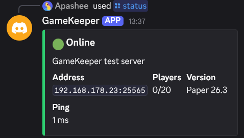

# Managed Minecraft server with Docker

A ready-to-use Minecraft Java server for a VPS or home server: one command to start it,
automatic backups, plugins installed from a list, one-command restore.
Built on the widely used [itzg/minecraft-server](https://github.com/itzg/docker-minecraft-server)
and [itzg/mc-backup](https://github.com/itzg/docker-mc-backup) images.

Pairs with [GameKeeper](https://github.com/gabrielelosero/gamekeeper-discord-bot),
a Discord bot that shows the server status and online players with `/status`:



## Features

- **Paper, Vanilla, Fabric or Forge**, latest or any specific version: set it in `.env`
- **Automatic backups** every 6 hours (configurable), skipped while no one is online,
  old ones deleted after 7 days. World saving is paused during the copy, so backups are never corrupted
- **One-command restore** that keeps the current data aside, so a restore can always be undone
- **Plugins and mods** from [Modrinth](https://modrinth.com) by name, downloaded at startup
- **Auto-restart** on crashes and after a reboot, health check, log rotation
- Admins, whitelist, difficulty, player limit, RAM: all in one `.env` file

## Requirements

- Linux with Docker and Docker Compose
- RAM: 2 GB for a few friends, 4–6 GB for 10–20 players or modpacks (plus ~1 GB for the system)
- Port 25565/TCP open in the firewall (and forwarded on the router for a home server)

## Quick start

```bash
cp .env.example .env
# set at least RCON_PASSWORD (e.g. openssl rand -hex 16) and your username in OPS
docker compose up -d
docker compose logs -f minecraft   # wait for "Done (...)! For help, type "help""
```

Then connect from Minecraft to `<server-ip>:25565`.

## Configuration

Everything is in `.env` (see `.env.example` for all options):

| Variable | Default | Description |
|---|---|---|
| `SERVER_TYPE` | `PAPER` | `PAPER` (plugins, best performance), `VANILLA`, `FABRIC`, `FORGE` |
| `MC_VERSION` | `LATEST` | Minecraft version, e.g. `1.21.4` |
| `MEMORY` | `2G` | RAM for the server |
| `OPS` | | Admin usernames, comma-separated |
| `ENABLE_WHITELIST` / `WHITELIST` | `false` | Allow only listed players |
| `MODRINTH_PROJECTS` | | Plugins/mods to install, e.g. `luckperms,essentialsx` |
| `RCON_PASSWORD` | | **Required.** Remote console password, used by backups |
| `BACKUP_INTERVAL` | `6h` | How often to back up (`30m`, `6h`, `1d`...) |
| `PRUNE_BACKUPS_DAYS` | `7` | Delete backups older than this |
| `PAUSE_IF_NO_PLAYERS` | `true` | Skip backups while no one is online |

After changing `.env`, apply it with `docker compose up -d`.

## Everyday operations

```bash
docker compose exec minecraft rcon-cli            # server console (type "help", exit with Ctrl+D)
docker compose exec minecraft rcon-cli "op Steve" # run a single command
docker compose exec backup backup now             # back up right now
docker compose restart minecraft                  # restart the server
docker compose pull && docker compose up -d       # update the images
```

## Backups and restore

Backups are `.tar.gz` archives in `backups/`. They contain the world, configuration and
plugins; the server jar and libraries are downloaded again automatically, so they are left out
to keep backups small.

```bash
scripts/restore.sh                                     # list backups
scripts/restore.sh backups/world-20261028-132544.tar.gz
```

The restore stops the server, moves the current data to `data.before-restore-<date>/`,
extracts the backup and starts the server again.

For off-site safety, copy `backups/` to another machine or to cloud storage
(e.g. with `rclone` or `rsync` in a cron job).

## Files

```
docker-compose.yml   # server + backup services
.env.example         # all settings, copy to .env
scripts/restore.sh   # restore a backup
data/                # server files and world (created at first start, not in git)
backups/             # backup archives (not in git)
```
